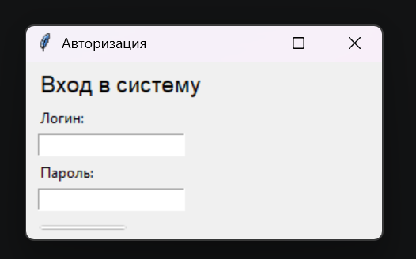

# Окно авторизации

## Участники команды
* Просин Никита (разработчик)

## Назначение
Прототип окна авторизации для входа пользователя в систему (разработано на Python с использованием Tkinter).

## Техническое задание
* Заголовок окна: «Авторизация»
* Размер окна: 300×150
* Метка-заголовок: «Вход в систему»
* Поля ввода: «Логин» и «Пароль» (символы скрыты звёздочками `*`)
* Кнопка «Войти» с выводом приветствия при нажатии

## Запуск
Для запуска приложения необходимо выполнить в файле `main.py`:
```bash
python main.py
```

## Скриншот 
